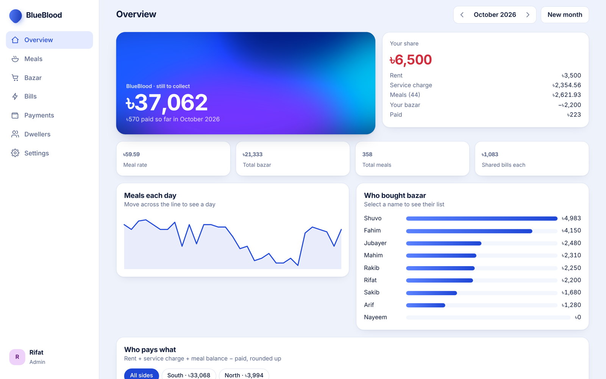
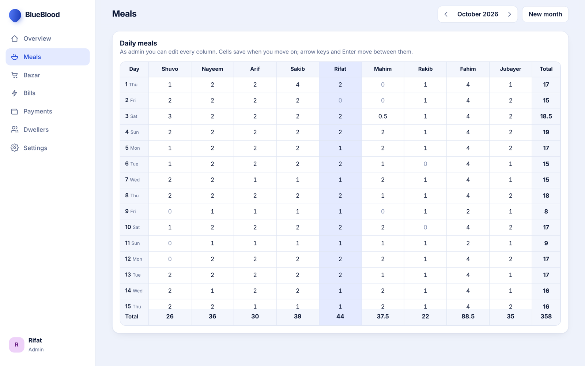
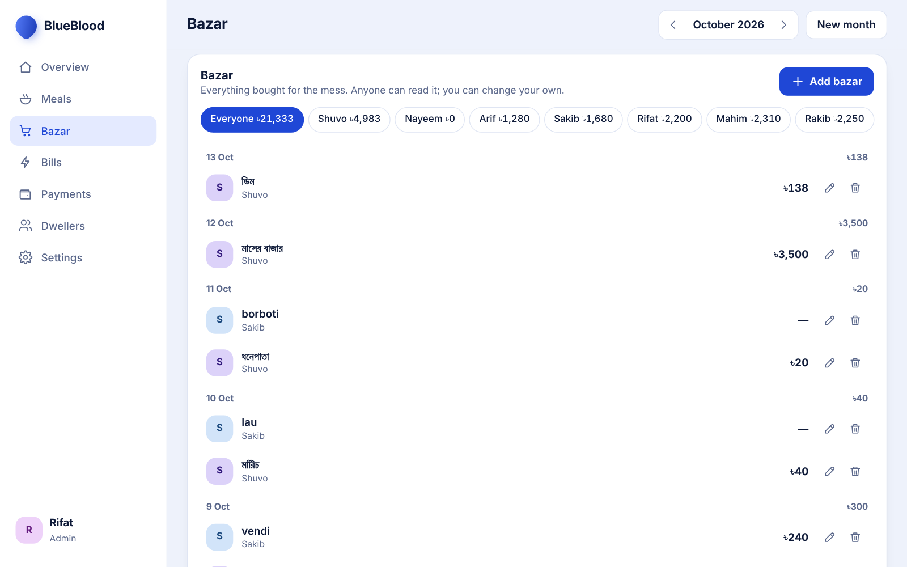
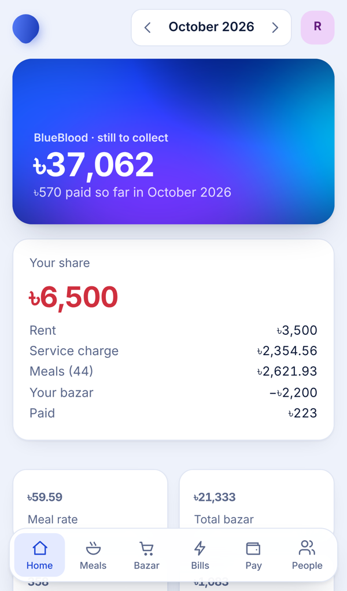
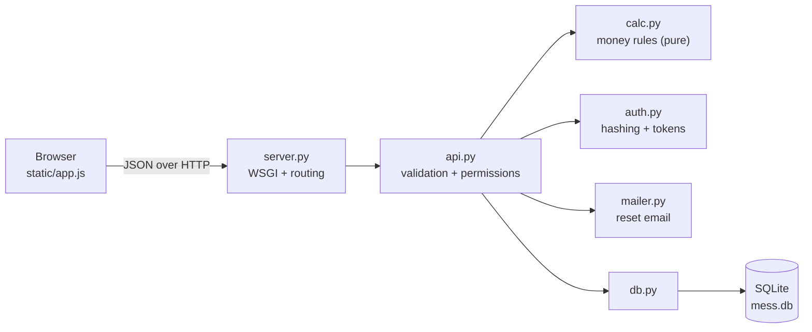

# BlueBlood

**A shared-flat cost tracker that replaced our monthly Excel sheet.** Meals, bazar (grocery runs), bills, payments and who owes what, with an account for every flatmate and permissions enforced on the server.

[](https://github.com/rifathasan404-blip/blueblood/actions/workflows/tests.yml)




<sub>Screenshots use our real October 2026 numbers with flatmates' names replaced.</sub>

---

## The problem

In Bangladesh, students and young professionals often share a flat as a *mess*: everyone eats from a shared kitchen, takes turns buying groceries, and splits rent, the cook's salary, gas and electricity. Ours ran on an Excel sheet. One person kept it, everyone else had to ask "how much do I owe?", and a wrong formula or a missed meal meant arguments at the end of the month.

BlueBlood puts that sheet online. Every flatmate signs in, records their own meals, bazar and payments, and sees the same numbers, worked out the same way the sheet did.

## Features

- **Meal grid** for the whole month, editable like a spreadsheet (arrow keys, Enter, saves on blur).
- **Bazar, bills and payments** with per-person filters. Bill amounts accept sums like `100+30+150`, like an Excel cell.
- **Automatic settlement**: meal rate, each person's balance, service charge and final amount due, matching the original sheet to the taka.
- **Sides**: groups of rooms that share some bills but not others, each with its own add-on charge.
- **Accounts and roles**: anyone can ask to join; the admin approves and links them to their name on the sheet. Dwellers can change only their own entries; one admin manages everything.
- **Month rollover** that carries people, rents, sides and recurring bills forward.
- **Password reset by email**, light and dark themes, and a layout that works on phones.

| Meals | Bazar | Phone |
|---|---|---|
|  |  |  |

## How the money is worked out

The rules come from the `Final` sheet of our Excel file and live in [`calc.py`](calc.py), a pure module with no database or web code.

1. **Meal rate** = total bazar ÷ total meals.
2. **Balance** = meal rate × your meals − what you spent on bazar.
3. **Bills** are split per head, across everyone or one side, rounded up where the sheet rounded up.
4. **Service charge** = shared bills + your side's bills (if charged) + the side's add-on.
5. **Due** = `ROUNDUP(rent + service charge + balance − paid)`, rounding away from zero exactly like Excel.

Floating-point noise (`3000.0000000001`) is trimmed before rounding, so nobody is charged an extra taka by accident.

## Architecture



| File | Responsibility |
|---|---|
| `server.py` | WSGI entry point, routing, sessions, transactions, security headers |
| `api.py` | 38 JSON routes, input validation, permission checks |
| `calc.py` | The month's money rules, kept free of database and HTTP code |
| `db.py` | SQLite schema, constraints and startup migrations |
| `auth.py` | PBKDF2 password hashing and random tokens |
| `mailer.py` | Password reset email over SMTP |
| `static/` | Single-page interface in plain JavaScript modules and CSS |
| `tests/test_app.py` | 84 tests run against the real WSGI app |

**Design decisions**

- **Python standard library only.** Nothing to install, so it runs on any free WSGI host.
- **Every route declares who may call it** (`PUBLIC`, `WAITING`, `USER`, `ADMIN`) in one table, and the check runs centrally before any handler. A route can't be added without deciding its access level.
- **Rules that must never break are enforced by the database too**: a partial unique index guarantees there is never a second admin, and foreign keys keep history when an account is removed.
- **Each request is one transaction**: a handler's changes are all committed or all rolled back.

## Security

- Passwords hashed with salted PBKDF2-SHA256 (300,000 iterations) and compared in constant time.
- Only hashes are stored for passwords, session tokens, reset links and admin codes.
- Session cookies are `HttpOnly`, `SameSite=Lax`, and `Secure` over HTTPS.
- Rate limits on sign-in, sign-up, password reset and admin codes.
- CSRF protection from SameSite cookies, an `Origin` check, and JSON-only request bodies.
- XSS protection from escaping every value in the interface plus a strict Content-Security-Policy.
- Sign-in and password-reset responses don't reveal which accounts exist.
- Reset links use a configured public URL, never the request's `Host` header.

## Testing

```bash
python3 tests/test_app.py
```

84 tests cover the money rules, accounts, approval, permissions on every route, admin handover, input validation and security headers. The settlement tests load our real October sheet (names changed) and assert the exact amounts the Excel file produced, so any change to the rules that alters a single taka fails the build. Tests run on every push with GitHub Actions.

## Run it locally

Requires Python 3.10 or newer. Nothing else.

```bash
git clone https://github.com/rifathasan404-blip/blueblood.git
cd blueblood
python3 server.py
```

Open http://127.0.0.1:8100 and set up your mess. On your own computer the first account becomes the admin without a code. Use `--host 0.0.0.0` to open it from a phone on the same Wi-Fi.

## Deploying

BlueBlood runs on any host that serves Python WSGI apps. It is deployed on PythonAnywhere's free tier. See [docs/DEPLOYMENT.md](docs/DEPLOYMENT.md) for step-by-step instructions, email setup, admin codes and backups.

## How this was built

I built BlueBlood to fix a real problem in my own flat, and I built it with AI coding assistance (Claude), which wrote much of the code.

My part was:

- Defining what the app had to do: the money rules from our sheet, and who is allowed to change what.
- Checking every calculation against our real October sheet until the dues matched to the taka.
- Testing it with my flatmates, reporting bugs and deciding on fixes.
- Deploying it, and running and maintaining it for the flat.

I have since studied the codebase part by part (HTTP and WSGI, the data model, authentication, testing and deployment) and can explain how each piece works and why it was designed that way.

## Roadmap

- [ ] Store money as integer paisa instead of floats
- [ ] Make development mode an explicit setting instead of inferring it from the bind address
- [ ] Only trust `X-Real-IP` when running behind a known proxy
- [ ] Audit log of who changed which entry
- [ ] Spending by bazar category
- [ ] Browser tests with Playwright

## License

[MIT](LICENSE) © 2026 Rifat Hasan
